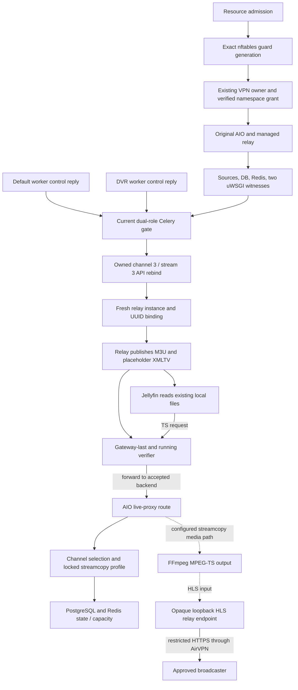

# Is dual-Celery readiness necessary for DW English recovery?

**The dual-pong gate is a full-backend acceptance policy, not a demonstrated broadcaster-specific security prerequisite. However, this offline review does not establish that omitting default-worker readiness is safe.** Recording-specific DVR work and the locally generated guide are outside the reviewed live-serving dependencies. Removing only the DVR check would not solve the latest failure, which lacked a conforming **default** reply.

**Recommendation: option A. GO to prepare a minimal structured-reply correction that preserves both positive worker-role requirements and the existing deadlines. NO-GO for preparing an omitted-default/both-worker recovery policy under option B on the present source coverage.** No root cause or guaranteed fix is claimed. Nothing was implemented, installed or started.

## Evidence and source boundary

Review baseline: `f7df20f76c13d4b5c7385a3bc448366b08138ccc`, [latest attempt](dispatcharr-celery-recovery-attempt-results.md). AIO remains the original immutable `sha256:14c8373377b8a7244e9b49d65a364798d02e2ace405b04730dba7a149f7cad21`.

This task used only local repository objects, retained original upstream source and prior sanitized evidence. **26 retained upstream source files** were checked against the existing API/source/audit pin inventories. Original registrar, relay, Caddy, exports, health and binding modules matched their accepted original manifest hashes; the lifecycle matched installed `0df62a94…` bytes. Older227122d unit ordering was read from Git objects, not the newer native-hardening drop-ins. No application module was imported or executed.

[Source/evidence inventory](../configs/dispatcharr-iptv/celery-readiness-necessity-review-results.json) records hashes and coverage. Crucially, the retained offline trees do **not** contain the complete original `apps/proxy/live_proxy` request handler, server/input manager, output generator and cleanup implementation. The four-file image readiness patch has retained hashes and an [artifact-review description](dispatcharr-permanent-streaming-artifact-review.md), but its complete bodies are not present here. Those gaps prevent an exhaustive negative claim about hot-path Celery dependencies. No Docker, SSH or network source retrieval was used to fill the gap.

## DW English dependency graph

The graph combines exact reviewed lifecycle/configuration with the previously deployed data path. Dashed media edges identify the portion not fully source-audited in this offline set; they are not proof that its internals lack Celery calls.

### Startup and registration

`installed-baseline/lifecycle.py:start` starts/verifies the VPN, publishes its grant, starts AIO/relay and waits for their container health. It then invokes `backend.py`. **A backend failure blocks registration and gateway startup and triggers scoped shutdown**, regardless of whether HTTP or a single Celery worker looks usable.

`permanent-streaming/register.py:reconcile` uses supported local APIs, exact owned detail checks, shared-reference checks, the pinned ACL and locked streamcopy profile. It updates the owned stream's fresh relay endpoint and channel fields, verifies the instance again and commits private ownership/binding receipts. It contains no Celery inspection, task wait or task-result dependency.

For the existing manual channel, registration does not change native EPG mappings or create a provider account. Reviewed `ChannelSerializer.update` persists the fields/link order synchronously. `apps/channels/signals.py` assigns custom streams to the locked custom account and queues programme import only for relevant native EPG assignment/creation cases. Therefore absence of a direct registrar Celery call does not authorize arbitrary channel/account creation: a recovery policy would have to require the **existing custom account, active profile, channel3/stream3 and exact fields already present**, and refuse any path that could create accounts, remap EPG or trigger imports.

### Live selection, proxying and output

The exported M3U points to the existing channel UUID's `/proxy/ts/stream/…` path on the protected gateway. Caddy admits only that reviewed TS route/method/query shape, strips untrusted identity headers, enforces route/response filtering and rejects other media formats/direct-provider output. Client access control also depends on the unchanged firewall and Dispatcharr ACLs, not Caddy alone. It forwards to AIO9191; it does not dispatch Celery work.

The pinned `Channel.get_stream` implementation directly queries channel/stream/account/profile rows and Redis assignment/capacity state. `get_stream_profile` resolves the configured profile. The registrar requires a unique active locked FFmpeg profile containing streamcopy and MPEG-TS output. Thus DB, Redis, the existing custom-account/profile state and actual proxy/FFmpeg functionality remain essential; an HTTP200 or Celery pong alone proves none of them.

The configured media chain is Dispatcharr proxy/streamcopy → fresh opaque relay endpoint → allowed HLS manifest/segments over the VPN → TS response to Jellyfin. Relay fetching, rolling request budget, DNS/TLS/destination enforcement, generation checks and response limits run in the relay's own process/threads, not Celery. **The full proxy/FFmpeg invocation and cleanup call graph is the source-coverage gap**: inspected model calls into live-proxy slot/metadata helpers are not an exhaustive audit of those helpers. This review cannot certify that no startup/cleanup/failover code delegates to default tasks.

### Playlist and guide

`exports.py:documents/publish` produces the single channel9001 M3U and an explicitly labeled renewable **availability placeholder**, not broadcaster programme listings. `relay_main.py` watches the committed binding and publishes the pair initially and hourly from its own thread. Jellyfin reads the existing local export directory. This path does not use native EPG imports, programme matching or a Celery guide-renewal job.

That removes native XMLTV-fetch/parse dependency for this particular placeholder path; it does not make all Dispatcharr EPG/background functionality optional.

## What each Celery worker provides

| Function | Reviewed dependency | Consequence for this recovery |
| --- | --- | --- |
| Existing managed acceptance | Explicitly requires exactly one default and one DVR conforming positive reply | Both are mandatory **under current installed policy**. No review-only bypass exists. |
| Provider refresh, category/channel import, native EPG parse/matching | Celery default tasks in M3U/EPG/channel code | Not invoked by the reviewed existing manual rebind/relay placeholder workflow. May still exist as scheduled/queued maintenance and cannot be silently ignored. |
| Worker startup recovery and maintenance | `dispatcharr/celery.py:on_worker_ready` queues recording recovery and version-check work, protected by Redis NX dispatch locks | A ready DVR worker is not a substitute for default task execution. Startup jobs/debt and recording state matter even if no new recording is requested. |
| Actual DVR recording | `run_recording` is routed to queue `dvr`; default worker consumes `celery`, DVR worker consumes `dvr` | Recording functionality requires its worker. Current task does not authorize recording or a new DVR configuration. |
| DVR's use of the stream | `get_dvr_stream_base_url` and `_dvr_capture_url` build an HTTP request to the existing TS proxy | The inspected direction is **recording consumes live proxy**, not evidence that live proxy invokes DVR. |
| Registrar, Caddy, HLS relay, local placeholder exports | No direct Celery task wait in these exact reviewed modules | Positive evidence for a narrower dependency set, but not proof that the unreviewed proxy internals/default cleanup can be omitted. |

The application `worker_ready` hook is important: removing task readiness without examining existing recording recovery, queued work and shared Redis state could leave stale/active recording consumers or unfinished cleanup. A live channel can be affected indirectly through occupied connection slots, Redis metadata and resources. Do not infer harmlessness merely from “FFmpeg handles streaming.”

## What remote-control readiness proves—and does not

The original backend's dual-role predicate requires command return0, exactly two regex-matching `OK/pong` replies and role prefixes exactly `default` and `dvr`. It was introduced as **whole-backend/DVR health acceptance**, consistent with the prior managed-stack requirements. The reviewed application/configuration does not establish a DW-specific security reason to require a DVR pong before local placeholder exports can be served.

A positive control reply demonstrates a broker/control round trip to that worker's consumer at that moment. It is not a completed task-pool test, a broadcaster fetch, usable TS readiness, safe shutdown proof, database correctness or VPN attestation. Conversely, a worker may be running yet fail to yield a conforming reply because of subscription/startup timing, reply timing, broker/context differences, an error response or representation/parsing issues. The retained Celery5.6.3/Kombu source publishes once and then collects; it does not repeatedly discover newly ready workers.

`inspect` returns success when it has replies; application-specific completeness still needs validation. Its native JSON mode is present in the retained implementation. Human formatting/style is a weaker machine interface than positive structured role responses. This does not establish that changing representation will recover the missing default proof.

## Latest evidence: precise interpretation

The [latest attempt](dispatcharr-celery-recovery-attempt-results.md) retained:

- Sources14/14, PostgreSQL/migration predicate, Redis predicate and two fresh uWSGI witnesses passed.
- Celery command returned **0** after **9.147665s**; stdout267 bytes, stderr0; capture complete.
- **One conforming parsed `OK/pong`: DVR.** Default presence=false describes the parser result, not absence of every possible default response.
- `reply_output_valid=false`; fixed classification `celery_unclassified_failure`.
- Effective broker comparison **unknown**, not a mismatch.
- Backend failed and registration/export rebind/gateway start were not reached. Managed cleanup left the stack stopped/protected.

**Could267 bytes be healthy but unrecognized output? Yes, it is possible; the retained evidence cannot decide.** The bytes were discarded deliberately, so length and return0 cannot reconstruct their contents. A nonconforming healthy default reply, a default error reply, unrelated log text, or a genuinely incomplete reply set cannot be selected as the root cause. No synthetic267-byte reconstruction was made.

The original role-count predicate independently fails on the parsed result; dropping only the new formatter check would not have accepted this invocation. A pure formatting defect has not been demonstrated, nor has a permanently failed default worker. Historical successful DW playback occurred with the normal stack; it is not a controlled test of streaming without either worker.

## Options A and B

| | A — preserve strict role readiness | B — recovery-only omitted check |
| --- | --- | --- |
| Evidence-supported preparation | Replace dependence on the human formatter with bounded native structured replies; keep explicit positive `pong` from both expected roles and existing bounds. | Only permissible after proving that each omitted check is unnecessary for the exact existing DW path, including shared state/startup/cleanup. That proof is incomplete for default here. |
| What is demonstrated | The latest complete response was not recognized as valid by the current grammar. This establishes an unresolved output-contract rejection, **not** a demonstrated parser-only bug or root cause. | DVR-only proof is broader than local-guide/registrar needs, but dropping DVR alone leaves the latest missing-default proof unresolved. |
| Safety | No relaxation of the required roles, security gates or positive response semantics. Still refuses a genuinely missing/error default response. | Can expose a partially functioning backend while task recovery, imports, scheduling or cleanup are broken; static-channel success can conceal shared-state debt. |
| Decision | **GO to prepare a narrow structured-reader correction; no implementation or new attempt in this task.** | **NO-GO to prepare a default/both-worker omission on present source evidence. No recommendation to remove only DVR as a recovery fix.** |

For A, the smallest preparation uses the existing CLI's JSON response mode within the same single inspection, eight-second reply window,40-second child bound and90-second backend limit. It validates actual positive replies for both roles without storing hostnames or raw output; malformed, ambiguous, missing or error replies remain failures. This is a candidate for offline review, not a guarantee of recovery and not permission to extend waits/retry. If the structured result still lacks a positive default response, preserve the refusal instead of converting it into success.

### Non-negotiable prerequisites for any future B proposal

These are evaluation criteria, **not an implemented policy or authorization**:

1. Complete pinned original proxy/input/output/cleanup call-graph proof that the omitted worker/control check is not required for this channel. No substitutes from native hardening, inferred absence or broad no-Celery grep.
2. Fresh existing-state proof: only owned channel3/stream3 for this recovery; matching UUID/account/link, active locked custom account/profile1, group2, exact ACL digest; no record recreation, shared-stream conflict, pending/uncertain journal or provider/EPG import requirement.
3. No active/pending/interrupted recording, timer, recovery job or relevant queue debt whose omission could affect the shared proxy/resources. Offline historical idle evidence is not fresh proof. Existing workers remain configured/start normally; an omitted control check does not authorize stopping workers or altering scheduling.
4. All current source/image/67-file pins, rollback/recovery copies, admission thresholds, exact guard/nftables, VPN owner/namespace grant, DNS/IPv6, mounts/capabilities/resource limits and revoked provider authorization still pass.
5. PostgreSQL/migration state, configured Redis, both fresh uWSGI witnesses and the original proxy's canonical input/output readiness remain mandatory. A worker omission cannot replace Redis/web-worker/proxy checks with HTTP liveness alone.
6. Fresh relay identity/generation, HLS destination/DNS/TLS/request-budget enforcement, local health and ownership-verified API rebind must pass. Current exports/UUID/relay instance must agree, with current placeholder XMLTV and Jellyfin-readable permissions.
7. Gateway remains last; its access/response filtering and running security verifier pass. Jellyfin's intended channel/tuner/guide remain intact, with unrelated services/networks unchanged. No playback/provider test is inferred or newly authorized.
8. Explicitly reviewed temporary scope, honest degraded-capability reporting, preserved diagnostics and conflict-checked scoped cleanup/rollback. No generic skip flag, automatic retry, timeout extension or security bypass.

Even these prerequisites do not constitute actual live-media validation. Source review cannot promise playback while services are stopped, and this task authorizes none.

## Recommendation and stop point

The gate is **broader than several verified DW-specific dependencies**, especially local guide generation and recording-independent exports. It has **not been proven unnecessary as a whole**. The source gap and latest missing-default proof make an omitted-default policy unsupported; DVR-only omission does not target the observed blocker.

**Choose A's smallest preparation: a bounded structured role-response reader in the existing original readiness check, retaining both required roles and all current deadlines/security.** Treat this as a source-supported representation improvement, not a proven incident fix. Do not expand the infrastructure or diagnostic framework. Any implementation, installation or managed start needs separate authorization.

Only this report and its source/evidence inventory were added. No code, production files, database/Redis state, policies or services changed. No Docker/systemd/application operations, host contact, provider request, playback, test execution or recovery retry occurred. Production state is not freshly attested by this offline review; the latest incident remains stopped/protected, with Jellyfin healthy at its last recorded verification.
