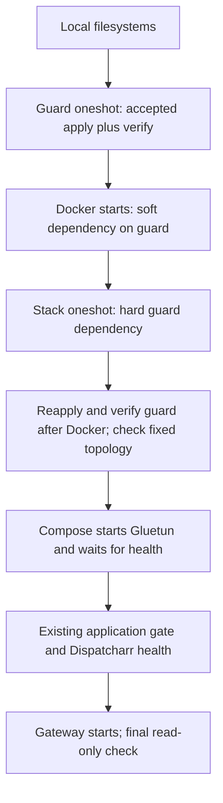

# Dispatcharr Phase 6B-3D — minimal production persistence plan

Date: 2026-11-15 US/Eastern. Target Rivendell, 10.10.20.30.
**Planning and offline validation only. No activation performed.**

**Recommendation: GO for this simplified design and a separately approved,
bounded installation/startup check once recovery prerequisites pass. NO-GO for
claiming unattended boot/failure recovery proven before target acceptance.**
No new VM, Docker daemon, cgroup controller or continuous supervisor is required.

## 1. Simplified architecture and current evidence

Use two ordinary systemd oneshot units: one installs/verifies the existing scoped
nftables guard; the other starts/stops the existing three-service Compose project.
A small Docker drop-in requests these units with soft dependencies. Only the
workload unit has hard guard requirements. Docker restart policies become `no`
for these three containers so the daemon cannot autostart them ahead of preflight.
Unrelated Docker services keep their existing policies and configurations.

Fresh read-only inspection confirmed:

| Item | Current state |
|---|---|
| Dispatcharr `2c1331d8e7d7…` | Healthy; started Nov 8 22:17:43 UTC |
| Dedicated Gluetun `dfa35e0d8614…` | Healthy; started Nov 8 22:15:22 UTC |
| Gateway `f60893c317fb…` | Healthy; started Nov 16 00:44:51 UTC |
| All three restart policies | `unless-stopped`; no explicit cgroup parent |
| Compose project/file | `rivendell-iptv`, `/docker/dispatcharr-iptv/compose.proposed.yaml` |
| App/gateway namespace references | Both point to the dedicated VPN container ID |
| Accepted scoped nftables table | Present |
| Docker / generic nftables units | Docker enabled; generic nftables disabled |
| Proposed guard/controller/stack units | Not installed |
| Accepted source hashes inspected | guard.py, security.py, both startup gates and Caddy match reviewed pins |

This check did not exercise playback, restart anything or certify current worker
semantics. It checked table presence; full semantic comparison is part of the
proposed one-shot verifier and later activation preflight.



Ordering alone is insufficient. The design also disables Docker autostart for
these containers, checks actual rules and topology before Compose, retains the
owner/app startup gates and uses namespace-local Gluetun filtering continuously.
The guard is installed using interface-name rules before the bridge exists, then
reconciled after Docker startup. Existing tests showed those rules do not require
the bridge to exist at installation; actual target boot remains unverified.

## 2. Retained and retired components

Retain unchanged:

- Accepted `guard.py`/`security.py` table, peer restriction, LAN scope and IPv6 rules.
- Dedicated Gluetun custom WireGuard, built-in kill switch, DNS controls, secret
  mounts and fixed Docker bridge/subnet/owner address.
- `vpn-owner-gate.sh` and `vpn-startup-gate.py` checks of the ready marker and VPN
  health, existing Compose health/dependency definitions and pinned images.
- Caddy content/header/redirect protections, namespace sharing and LAN listener.
- HLS enforcement source/configuration boundaries and trial artifacts. This plan
  starts only the current three-service base project, not an additional relay,
  channel or patched image. It does not make a former trial permanent.

Retire from activation: authenticated enrollment, HMAC records, custom cgroup
shutdown/slice, controller.py, polling lifecycle supervision and old persistence
units/override. Historical directories and reports remain intact. A new
[PERSISTENCE-STATUS.md](../configs/dispatcharr-iptv/PERSISTENCE-STATUS.md) marks the
selected proposal. No Phase 6B-3C artifact was present to evaluate; no conclusions
are attributed to missing work.

Reuse only the proven pure JSON canonicalization, exact table comparison and
fixed topology checks, extracted into a standalone `contracts.py`. It has no
controller/enrollment/cgroup imports. A short one-shot `verify.py` checks source
pins, actual rules/ready marker, exact network/namespace/ports/images and restart
policies. It emits pass/fail with values withheld; no secrets, signals or loops.

## 3. Exact proposed file changes

Candidate directory:
[minimal-phase6b3d](../configs/dispatcharr-iptv/minimal-phase6b3d/README.md).

| Repository candidate | Proposed target |
|---|---|
| `compose.persistence.proposed.yaml` | `/docker/dispatcharr-iptv/minimal-phase6b3d/compose.persistence.proposed.yaml` |
| `verify.py`, `contracts.py`, `accepted-table.template.json` | Same minimal directory on Rivendell |
| `units/dispatcharr-egress-guard.service` | `/etc/systemd/system/dispatcharr-egress-guard.service` |
| `units/dispatcharr-stack.service` | `/etc/systemd/system/dispatcharr-stack.service` |
| `units/docker.service.50-dispatcharr-order.conf` | `/etc/systemd/system/docker.service.d/50-dispatcharr-order.conf` |

Do not overwrite the accepted base Compose, guard, policy, secrets, images,
gateway or relay. The override changes only restart policies to `no`. It contains
no cgroup_parent override. The byte-identical accepted table template is reused.

Guard unit: `Type=oneshot`, `RemainAfterExit=yes`, local-storage dependency,
`Before=docker.service`, source-pin precheck, accepted guard apply, exact live
verification. **No ExecStop removes rules.** No generic nftables service enablement.

Stack unit: `Requires`, `After`, `BindsTo` and `PartOf` for Docker/guard as specified
in the candidate. It reapplies only the accepted table, validates preflight,
runs `compose up --detach --no-build --pull never --no-recreate --wait`, then
validates live topology. Readiness uses existing healthchecks, not an open port.
`ExecStopPost` stops only `gateway dispatcharr iptv-vpn`, including partial startup
failure. No down, volume deletion, orphan removal, pull or rebuild is used.

Docker drop-in: `Wants=guard stack` and `After=guard`, deliberately **not Requires**.
A failed guard blocks the stack but allows unrelated Docker startup. Disabling
the stack unit alone does not undo a Docker Wants dependency: rollback must also
remove the candidate drop-in before later Docker starts.

`Requires/After`, `BindsTo` and `PartOf` supply different startup, stop and restart
semantics; the graph is not a security boundary by itself.
[systemd 255 unit dependencies](https://www.freedesktop.org/software/systemd/man/255/systemd.unit.html).
`ExecStopPost` runs for startup failure paths as well as shutdown; cleanup failure
is reported instead of ignored.
[systemd 255 service commands](https://www.freedesktop.org/software/systemd/man/255/systemd.service.html).

Docker's `no` policy prevents automatic restart; Compose's healthy-dependency
checks govern startup, while dependency `restart: true` does not provide general
crash recovery. [Docker restart policies](https://docs.docker.com/engine/containers/start-containers-automatically/),
[Compose startup ordering](https://docs.docker.com/compose/how-tos/startup-order/).

## 4. Offline validation

| Required scenario | Result | What was actually established |
|---|---|---|
| Normal startup ordering | PASS | Static unit graph and explicit fixture ordering; actual boot not executed |
| Guard installation/verification failure | PASS | Modeled startup blocked; Docker soft dependency retained; stale marker/missing rule rejected |
| Missing Docker network | PASS | Fixed-contract validator refuses; unit does not implicitly create/reconcile missing network |
| Missing Gluetun | PASS | Missing owner refused before Compose startup |
| Container restart | PASS | Same namespace contract accepted; wrong live netns rejected; real restart not performed |
| Docker daemon restart | PASS (design/model) | PartOf/BindsTo, restart=no and post-Docker reapplication verified statically; actual daemon not restarted |
| Duplicate guard installation | PASS (semantic fixture) | Repeated identical table checks accepted, damaged table rejected; actual reapply not run this phase |
| Rollback / partial startup | PASS (fixture) | Scoped stop present; no down/data deletion/global flush; rules retained |

**12 new offline tests passed.** **56 historical offline regressions passed**
separately, retained as research checks rather than active controller requirements.
Native Compose schema validation passed with `--no-env-resolution --quiet`.
Native systemd-analyze verification passed for both unit files and a combined
static graph including the Docker drop-in. The graph used a non-executed Docker
unit placeholder to parse proposed dependencies; it was not a test daemon or
live service. Python syntax checks passed. No packets were sent this phase.

The first fixture run exposed two fixture errors: the stale-marker mock also
mocked template reads, and a network recreation fixture retained an old attachment
ID. Fixtures were corrected to represent the intended states; checks were not
relaxed. Final results passed.

Native verification ran on Denethor, not Rivendell's systemd 255 runtime. Real
startup, shutdown, API outage, network recreation and cold boot remain unproven.
Earlier disconnected packet tests support the existing layered policy only; no
new VM, Docker daemon, namespace lab or failure infrastructure was created here.

## 5. Predictable operations and limitations

| Event | Intended behavior / limitation |
|---|---|
| Normal boot | Guard before Docker; no engine autostart for IPTV; stack checks actual post-Docker rules before starting |
| `systemctl restart dispatcharr-stack` | Stops only dedicated project, reapplies/verifies guard, restarts in health order |
| Planned `systemctl restart docker` | Stack participates in stop/restart; unrelated services follow their existing policies. Requires separately approved live check |
| Guard unit stop/restart | Stack stop/restart propagates; guard rules deliberately remain installed. Verify semantics on target before routine use |
| App crash/unhealthy container | No automatic restart or custom supervisor. Docker health and systemd journal provide diagnosis; oneshot can remain active despite later failure |
| Normal app-only restart | Existing startup gate checks marker/VPN; shared namespace and host rules remain. Preferred supported operation is project unit restart |
| VPN container/network recreation | Stop stack first, recreate **stopped** resources from exact Compose files, validate fixed bridge/IPAM and shared references, then start unit. Do not recreate owner beneath clients |
| Missing network/container at start | Refuse. Administrator repairs exact stopped project in an authorized window; no automatic subnet/IP rewriting |
| Docker API unavailable during cleanup | Compose stop can fail; unit reports failure. No claim all processes stopped, no cgroup fallback. Namespace filter remains the intended egress layer |
| Global host nft flush | Unsupported privileged operation: may remove host/LAN/Docker protections; oneshots do not continuously detect it |
| Both host and namespace filtering removed | Unauthorized egress is possible; no claim to withstand removal of enforcement itself |

A marker alone can become stale after out-of-band rule removal. Therefore the
systemd path checks actual nftables structure; direct privileged `docker start`,
`docker restart` or base-only Compose operations bypass that preflight and are not
the supported maintenance interface. The existing gates add protection but are
not live host-rule verifiers. No polling framework is introduced to obscure this
limit. Planned rule maintenance must stop the dedicated stack first.

The existing host guard remains independent of Docker-managed iptables/NAT
chains. Reinstallation targets only `inet rivendell_iptv`; it neither flushes the
host nor restores a full ruleset snapshot. Docker backend migration and generic
nftables.service reload are excluded. A recreated network is accepted only with
the exact reviewed name/bridge/subnet/owner/IP and namespace references; numeric
network IDs may change during explicit stopped recreation.

## 6. Controlled installation — PROPOSED ONLY

All commands below require separate approval. They were not executed. No Docker
restart or host reboot is part of the initial activation. Expect a brief outage
of only these three dedicated services while stopped containers adopt restart=no;
startup health allowance is six minutes plus bounded checks. Jellyfin and existing
download services must not be restarted.

Prerequisites:

- Verified application-consistent backup on trusted storage and a restoration
  procedure. Earlier degraded backup/storage findings remain unresolved by this
  phase; do not silently treat an old crash-consistent VM archive as sufficient.
- Approved maintenance window, fresh SSH, current baseline and no active stream.
- Review actual base Compose/pins, root-protected secrets/mounts, free space,
  original unit/drop-in absence and source ownership. No older persistence/slice
  overrides may be active. Stage only this reviewed candidate folder at the
  root-owned `/root/dispatcharr-minimal-phase6b3d`; compare its manifest beforehand.
- A root-private recovery receipt must preserve original restart policies,
  file hashes/ownership and file-absence facts. Do not dump full container Env.

In an authenticated Rivendell root shell, after those gates:

```bash
set -euo pipefail
P=/docker/dispatcharr-iptv
S=/root/dispatcharr-minimal-phase6b3d
R=/root/dispatcharr-minimal-recovery-$(date -u +%Y%m%dT%H%M%SZ)
install -d -m 0700 "$R"
test ! -e /etc/systemd/system/dispatcharr-egress-guard.service
test ! -e /etc/systemd/system/dispatcharr-stack.service
test ! -e /etc/systemd/system/docker.service.d/50-dispatcharr-order.conf
systemctl cat docker.service > "$R/docker-unit-before.txt"
nft -j list table inet rivendell_iptv > "$R/guard-before.json"
docker inspect --format '{{.Name}} {{.Id}} {{.State.StartedAt}} {{.HostConfig.RestartPolicy.Name}}' \
  dispatcharr rivendell-iptv-vpn rivendell-iptv-gateway > "$R/containers-before.txt"
cp -a "$P/compose.proposed.yaml" "$R/base-compose-before.yaml"

install -d -m 0755 "$P/minimal-phase6b3d"
install -o root -g root -m 0644 "$S/verify.py" "$S/contracts.py" \
  "$S/accepted-table.template.json" "$S/compose.persistence.proposed.yaml" \
  "$P/minimal-phase6b3d/"
python3 "$P/minimal-phase6b3d/verify.py" inputs
BASE=(docker compose --project-name rivendell-iptv --project-directory "$P" -f "$P/compose.proposed.yaml")
DC=("${BASE[@]}" -f "$P/minimal-phase6b3d/compose.persistence.proposed.yaml")
"${DC[@]}" config --quiet --no-env-resolution
"${BASE[@]}" stop --timeout 60 gateway dispatcharr iptv-vpn
python3 "$P/guard.py" apply --policy "$P/private/egress-policy.json"
python3 "$P/minimal-phase6b3d/verify.py" guard
"${DC[@]}" create --no-build --pull never iptv-vpn dispatcharr gateway
python3 "$P/minimal-phase6b3d/verify.py" prestart

install -o root -g root -m 0644 "$S/units/dispatcharr-egress-guard.service" \
  "$S/units/dispatcharr-stack.service" /etc/systemd/system/
install -d -m 0755 /etc/systemd/system/docker.service.d
install -o root -g root -m 0644 "$S/units/docker.service.50-dispatcharr-order.conf" \
  /etc/systemd/system/docker.service.d/50-dispatcharr-order.conf
systemd-analyze verify /etc/systemd/system/dispatcharr-egress-guard.service \
  /etc/systemd/system/dispatcharr-stack.service
systemctl daemon-reload
systemctl start dispatcharr-stack.service
python3 "$P/minimal-phase6b3d/verify.py" running
systemctl status dispatcharr-egress-guard.service dispatcharr-stack.service --no-pager
```

Do not proceed after any failed command: use the scoped rollback below. Before
installation confirm the new directory does not overwrite a prior candidate;
if it exists, capture/reconcile it instead of blindly copying. The staged manifest
is an ordinary review/integrity receipt, not authenticated workload enrollment.

Post-start acceptance: fresh SSH; exact nft table and marker; three healthy
containers with restart=no; only intended listener; application-check.sh for
migrations/workers; original Gluetun/qBittorrent/Jellyfin/NZBGet identities/health
unchanged; no unexpected processes/providers. These are read-only checks, not
stream tests. If acceptance passes, separately confirm authorization for boot
persistence before enabling:

```bash
systemctl enable dispatcharr-egress-guard.service dispatcharr-stack.service
systemctl is-enabled dispatcharr-egress-guard.service dispatcharr-stack.service
systemctl cat docker.service
```

The installed Docker Wants drop-in also pulls the units on a subsequent Docker
start even if they are not explicitly enabled; installing it is already a future
startup behavior change and must be covered by approval. Do not restart Docker
to adopt it during this initial window. Later, separately authorize a planned
stack restart, then a Docker restart, then a host reboot if desired; record guard,
namespace, health and neighboring-service evidence at each stage. No new VM is
required. Do not claim these tests have passed until observed.

## 7. Scoped rollback — proposed, not executed

Use the recorded recovery directory, approved root shell and the same `P`, `DC`
and `BASE` arrays. Leave the accepted firewall table and startup-marker directory
in place throughout. Restore only the three-service restart-policy deployment;
no historical controller, cgroup slice or daemon is installed as fallback.

```bash
# First keep the accepted protections valid.
python3 "$P/guard.py" apply --policy "$P/private/egress-policy.json"
python3 "$P/minimal-phase6b3d/verify.py" guard
systemctl stop dispatcharr-stack.service
"${DC[@]}" stop --timeout 60 gateway dispatcharr iptv-vpn
states=$(docker inspect --format '{{.State.Running}}' \
  dispatcharr rivendell-iptv-vpn rivendell-iptv-gateway)
test "$states" = $'false\nfalse\nfalse'

# Only candidate files proven absent before installation may be removed.
systemctl disable dispatcharr-stack.service dispatcharr-egress-guard.service
systemctl stop dispatcharr-egress-guard.service
rm -- /etc/systemd/system/docker.service.d/50-dispatcharr-order.conf
rm -- /etc/systemd/system/dispatcharr-stack.service \
  /etc/systemd/system/dispatcharr-egress-guard.service
systemctl daemon-reload
cmp -- "$P/compose.proposed.yaml" "$R/base-compose-before.yaml"
"${BASE[@]}" create --no-build --pull never iptv-vpn dispatcharr gateway
"${BASE[@]}" up --detach --no-build --pull never --no-recreate --wait \
  --wait-timeout 360 iptv-vpn dispatcharr gateway
```

If `systemctl stop` reports a prior failed unit or cleanup failure, inspect it;
confirm the explicit scoped Compose stop and all three false states before
continuing. If Docker is unavailable or any task remains running, **stop rollback
and report unconfirmed shutdown**. Do not remove rules, broaden networking or
substitute cgroup/process-name kills. Keep SSH and existing media services intact.

After base deployment restoration, compare the three restart policies to the
receipt (currently all `unless-stopped`), health, namespace references, listener,
exact guard and neighboring services. Base-only creation restores the original
restart policy; it intentionally returns the previous lack of managed persistence.
Do not present that rollback state as boot-hardened. Keep the unused candidate
folder and root-private evidence for diagnosis; delete no application data or
images. No global saved-ruleset restore is used.

If activation stops before units are installed, use scoped Compose stop/false-state
verification and the base create/up restoration steps only. If a supposedly absent
unit/drop-in existed at preflight, do not use this removal sequence: reconcile its
captured contents and ownership instead.

## 8. Decision

**GO for the minimal plan, with controlled activation separately authorized.**
The controller/enrollment/cgroup architecture is retired from consideration for
this installation; no new VM or daemon is a prerequisite.

**NO-GO for installation until backup/recovery and preflight checks pass, and no
claim of proven unattended reboot/failure behavior before target observation.**
The remaining risks are ordinary, explicitly bounded service recovery and
privileged control removal, not reasons to add another controller framework.
This phase ends at preparation: no services, rules, restart policies, units,
Jellyfin settings, images, relay or streams were changed.
