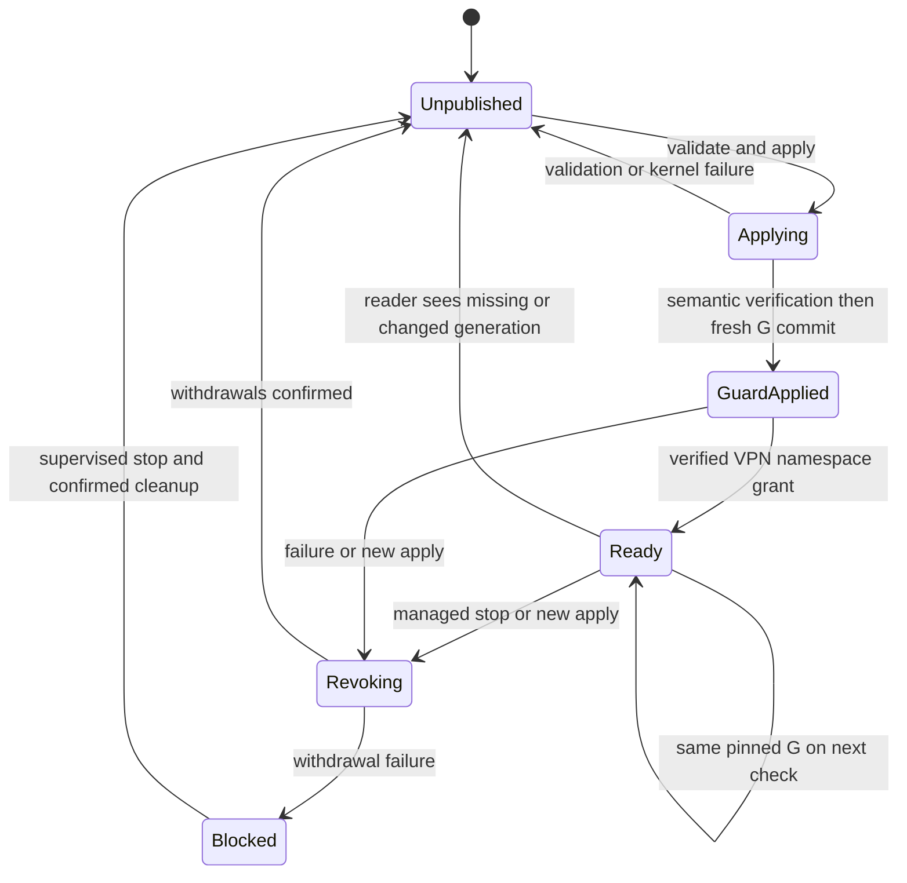

# Dispatcharr trusted guard readiness lifecycle design

2026-11-17 UTC. Andrew’s Rivendell (`10.10.20.30`), VM 130 on Orthanc. Repository `APMurtha/homelab-operations`, branch `docs/udm-pro-max-migration-prep`.

**Recommendation: conditional GO for a separate offline implementation of the bounded contract below; NO-GO for installation or deployment.** Approval must explicitly accept asynchronous manager/relay cleanup and the trusted directory-replacement protocol. Zero-window crash revocation, arbitrary privileged directory replacement, or continuous kernel/VPN-owner proof from a readiness file are **not** provided. If those stronger guarantees are required, this design is NO-GO under the no-monitor/no-new-service constraints.

This commit contains only a design and isolated executable model/tests. No protected source, unit, candidate, manifest or production state changes. Candidate `776f9843228148fe3d1fd744089f97fb0c82601e` remains unchanged. Baseline evidence: [guard-interface assessment](dispatcharr-permanent-streaming-guard-interface-fix.md) at `a7e94f0`; [deployment report](dispatcharr-permanent-streaming-deployment.md), section 13 at `38855f7`; [implementation report](dispatcharr-permanent-streaming-implementation.md). The original three-container stack is untouched; no fresh live-health claim is made.

## Existing paths and confirmed gap

| Source/path | Current effect or dependency |
|---|---|
| `guard.py main(): apply` | Loads policy, validates root-private inputs and WireGuard peer, then unlinks private `ready`; nft check/apply; temp file/fsync/atomic replace with the policy digest. Early failures occur **before** unlink. |
| `guard.py main(): check` | Syntax-only; does not authorize or revoke readiness. Keep read-only checks separate from apply. |
| `security.py` | Strict private policy parsing/digest, WireGuard validation and rules rendering. No generation or public status. |
| Guard base unit | Before Docker; inputs verifier → apply → semantic guard verifier; RemainAfterExit, UMask 0077, no ExecStop. |
| Stack base unit / effective 20 drop-in | Inputs → unchanged admission → direct guard reapply → prestart → scoped Compose; stop/failure cleanup stops only dedicated components. Requires/BindsTo/PartOf the guard and Docker units. |
| Candidate 30 drop-in / lifecycle | Same admission/guard sequence plus runtime preparation; starts VPN/AIO/relay, verifies backend, registers, then gateway. Scoped stop on failure. |
| Minimal/candidate verifiers | Check source pins, exact live nftables table, private ready digest, container/network namespace and source/image contracts. These are point-in-time checks. |
| VPN owner and AIO gates | Root readers of private `/guard/ready`, compared with the policy digest. These are startup gates; the AIO also challenges existing VPN health. |
| Relay `check()` | Direct private marker read at startup, resource handling, fetch boundaries, health challenge and existing two-second state-writer checks. UID 1000 cannot traverse root 0700. |
| Health/registration/binding | Health correlates current opaque relay instance and stats; registrar checks it before work/commit; binding checks call health again. |
| Historical `persistence-phase6b3/controller.py` | Retired controller can invoke apply and directly unlink private ready in `Backend.revoke`; its source/artifact pins are old. Do not reactivate or bless those pins for the new lifecycle. |

The accepted private directory is root:root **0700**, its digest marker root:root **0644**. The production generic relay refusal does not establish the exact caught exception; the permission incompatibility was independently confirmed. The prior assessment proves plain file binds/copies cannot observe every old-guard failure. No hidden generation currently exists: equal policy bytes produce equal marker contents after reapplication.

## Recommended minimal architecture

Use the existing root-owned guard program as publisher, existing systemd units as failure/stop supervisors, and **one read-only directory bind** for the relay:

| Object | Ownership/mode | Contents and purpose |
|---|---|---|
| `/run/dispatcharr-guard` | root:root 0700, unchanged | Existing private marker; new writer lock and private generation/anchor metadata. No access by relay. |
| `/run/dispatcharr-guard/ready` | root:root 0644, same bytes as now | Policy digest + newline for original root AIO/VPN consumers. |
| `/run/dispatcharr-guard-status` | root:root 0755 | Stable per-boot public anchor; only the two minimal assertions below. No policy, endpoint, credentials, logs or process-control files. |
| `guard.json` | root:root 0644 | Exact fields: schema version, host boot UUID, fresh 256-bit generation G, policy SHA-256. Presence is the guard-publication commit. |
| `grant.json` | root:root 0644 | Same four fields plus nsfs device/inode identifying the host-verified VPN-owner namespace for this managed start. No Docker credential, private address or source URL. |
| Relay mount `/guard-status` | bind directory read-only; no capabilities | Current-path lookup of the two assertions on every check. Replaces only relay’s private guard-directory bind. |

G is random on **every** successful apply, even unchanged policy; it is not the policy digest or the relay’s opaque endpoint instance. Grant publication is a separate startup assertion because the guard runs before Docker and cannot honestly assert VPN ownership then. The full owner container/image/network identity stays in root-private verification evidence, not the public interface.

The new directory is a public projection of trusted lifecycle decisions, not a copied private `ready`. No daemon, new network listener, host timer or polling service is added. No marker lease requiring periodic publisher refresh is introduced. Existing relay checks remain; existing nftables and VPN kill switches remain the actual network enforcement.

### What a successful relay check means

A success means that at the check’s final observation:

1. The stable root-owned public anchor and bounded, regular, non-symlink, single-link files have exact reviewed modes/fields.
2. Both assertions describe the expected policy digest and current host boot, and agree on G.
3. G and the startup grant equal the values pinned by **this relay process** at bootstrap. A running relay never adopts a new G automatically.
4. The relay’s actual `/proc/self/ns/net` nsfs identity equals the startup grant.
5. The trusted guard published G after successful application **and semantic readback verification** of the exact accepted nftables table; the trusted host publisher inspected the pinned, healthy VPN owner and namespace before granting this managed start.
6. No observed withdrawal/replacement has invalidated those assertions yet.

This is an authorization snapshot, not a continuously renewed attestation. A grant proves an owner/namespace check at publication, not that Docker ownership, tun0, DNS, IPv6 settings or VPN health can never change afterward. A matching namespace inode alone does not prove that its original owner process is still alive. Existing health, host acceptance checks, no-autorestart policy and managed-only lifecycle remain necessary. Unexpected out-of-band owner exits/replacements may leave stale status until a managed verifier/operation detects them; they are not magically detected by files. Network kill switches still operate independently.

A readiness file cannot prove continuous kernel enforcement. External root can mutate nftables after readback without changing a file; this design cannot detect that without another trusted observation. Compromised root, Docker daemon or kernel is outside the integrity threat model. A compromised relay can ignore its own check; the host firewall/VPN architecture must still constrain it.

## Trust boundaries and supported operations

Trusted: host kernel, root administrator following the maintenance protocol, pinned guard/lifecycle/verifier code, systemd, Docker control plane, root-only private inputs, and exact accepted nftables/VPN policy. Untrusted: media/request clients, broadcaster data, non-root services and UID 1000 as a filesystem writer. Treat public assertions as readable, not secret bearer credentials.

Only the existing managed guard and stack units are supported apply/stop entrypoints. Future `guard.py apply` must revoke before parsing/validation and reject unmanaged context before applying rules; use the process’s expected systemd cgroup/unit, not an environment variable as authentication. Root can bypass any such check, so this is an operational boundary rather than protection against root. A bare standalone helper killed before its first instruction has no supervisor cleanup guarantee and is unsupported. Retired controller commands remain disabled by their old pins.

All supported owner, policy, guard-generation and public-anchor changes require quiescing the protected stack first. No unrelated service or Docker daemon restart is needed. Preserve current restart=no, scoped cleanup and admission thresholds. Do not use this contract to justify live policy replacement during streaming.

## Publication/revocation protocol and state machine

A single root-private `flock` serializes every apply, revoke and grant operation. Its file/anchor must not be replaced while a writer might hold it. Public anchor device/inode and boot identity are recorded privately; unexpected replacement blocks publication and managed startup. Root-only incomplete transaction metadata records intent for diagnosis; a previous public assertion is never restored after an incomplete new attempt.

**Outer lifecycle withdrawal:** insert a fixed-path coreutils unlink prehook before source/input verification and admission in both effective managed paths. It withdraws public guard/grant and legacy ready without parsing policy or executing changed publisher code. If it fails, do not apply/start. Existing manager failure cleanup must still stop only protected components. This covers a publisher that never starts, has invalid source, or dies before its own revocation. There is still a window if the outermost hook itself dies before its first unlink: manager cleanup must close it; no zero-time guarantee is possible.

**Apply:** obtain writer lock; withdraw all prior public assertions and legacy marker before any policy/WireGuard validation. Confirm absence, private directory integrity and public anchor identity. Validate private inputs. Run existing nft syntax/application transaction and existing exact semantic table/ready verification (publish legacy digest first to support the existing verifier). Generate fresh G. Stage public JSON inside the private 0700 directory on the same `/run` filesystem, write/fsync, then atomic rename into the public directory; sync directory metadata as appropriate. Public guard commit is last. No grant exists yet. Avoid a verifier cycle: add a semantic-policy-only verifier mode for this pre-publication readback, checking the exact table and legacy digest without requiring public readiness. The normal guard verification then checks public/private coherence after commit. Inputs verification remains source/configuration-only; candidate stopped/prestart verification requires valid guard G but no namespace grant, while running acceptance requires the full grant. The original three-service path never requires a relay grant. Any failure attempts all revocations and exits nonzero; never reauthorize the preceding generation.

**Grant/start:** after guard apply and unchanged CPU admission, start/wait **only the existing VPN owner first**. Inspect its exact ID/image/network namespace, tun0 route, kill switch, resolver/IPv6, local health and exact current guard/table. Under the same writer lock, recheck G and publish the minimal namespace grant. Then start/wait AIO+relay, perform backend and registration/export verification, and start gateway last, as today. These inspections/publication are not an atomic Docker/kernel transaction; exclusive administration and later running-contract checks remain necessary.

**Reader:** bootstrap pins G/grant/boot/expected policy and its own namespace. Every check opens the directory and current filenames with no-follow semantics, validates owner/modes/link count and size/schema/types, and reads guard → grant → guard. Any missing/invalid file, inconsistent pair, boot/policy/namespace mismatch or changed pinned generation rejects. Do not retain an open status-file descriptor as readiness; do not downgrade to digest-only or automatically rebind to new G. Add G to relay stats for host running verification; retain the existing opaque endpoint and health response/API behavior. Host acceptance correlates stats G with the current trusted records and fresh Docker/nft observations.

**Revoke/stop:** withdraw public guard first, then grant, then legacy marker where guard lifecycle ends/reapplies. A stack-only stop withdraws public assertions and stops its scoped containers; it need not remove the legacy marker or firewall table. Guard service stop/failure withdraws both public and legacy markers. Attempt every withdrawal despite individual errors and report incomplete revocation. Repeated cleanup is idempotent. Public deletion never flushes/removes firewall rules.



The diagram describes public authorization. Kernel firewall state is a separate axis and can remain correctly installed while public readiness is absent. Intermediate legacy publication is not relay authorization because the required public pair is incomplete.

### Stable-directory and supervisor rules

Keep the public directory inode stable across normal activations. A new guard-unit drop-in may use systemd RuntimeDirectory with mode 0755 and **preserve=yes**, leaving the empty anchor through stop/restart; `/run` clears at boot. Never remove/recreate or rename a populated anchor while any relay can retain a bind. During exceptional replacement: stop protected components, withdraw files through the **old anchor**, confirm the old bound view has no authorization, then retire/recreate and remount/reverify under a new approved generation. A deleted old directory also fails the reader’s link-count check. Do not rely only on changing the canonical host pathname.

An arbitrary privileged rename of a populated directory is undetectable to its old bind: tests demonstrate old reads still succeed. That is a rejected maintenance sequence/outside the trusted publisher protocol, not a solved attack. If anchor identity mismatches, block and stop protected components; do not silently adopt the new path. Root-private state must not bless an unexplained replacement.

Use guard-unit ExecStop and ExecStopPost withdrawal hooks; keep existing stack BindsTo/PartOf relationships. Both effective stack paths (20 baseline and 30 candidate) need unconditional stop/failure public withdrawal around their existing scoped Compose cleanup. A fixed-path unlink failure must not prevent attempting Compose stop: a sequence can record/continue that first failure, run the existing scoped stop, then assert withdrawal; if Compose itself fails, the unit is already failed. Never turn an ignored unlink into an overall success. No automatic retry or privileged escalation of the relay.

Systemd cleanup occurs after manager detection/scheduling and can itself fail. Exception/finally handlers inside the publisher are useful but do not handle SIGKILL, interpreter failure or host death; they cannot replace manager hooks. Following SIGKILL, flock closes automatically; subsequent authorized cleanup/recovery must reconcile the private intent and withdraw public state before another start. Host crash/reboot clears `/run`; boot UUID and fresh generation also reject replayed state.

## Failure and race analysis

| # | Scenario | Required outcome and limits |
|---:|---|---|
| 1 | Normal startup | Revoke old state, verify/apply exact policy, commit G, verify VPN owner, publish matching grant; relay pins it, backend/registration then gateway. No public pair before grant. |
| 2 | Reapply unchanged policy | New G despite identical digest. Old reader rejects on next check and cannot adopt G. New managed start/grant required. |
| 3 | Reapply changed policy | Revocation first; new G + new digest. Old configured digest rejects. Configuration/pin change needs separate review; no automatic adaptation. |
| 4 | Early policy validation failure | Outer/inner withdrawals precede validation; no publication or container start. Cleanup remains scoped. |
| 5 | Early WireGuard validation failure | Same as 4; unlike current guard, no unchanged old authorization survives a completed withdrawal. |
| 6 | Late nft failure/readback mismatch | Public state stays absent; no grant. Kernel transaction/readback outcome may be uncertain: preserve actual rules and inspect before rollback/start, never claim publication rollback restored a prior ruleset. |
| 7 | Crash before revocation | If outer prehook completed, public state already absent. If first revocation actor dies before unlink, old state remains until manager failure cleanup; tested counterexample. No synchronous detection guarantee. |
| 8 | Crash after revocation | Next reader check fails immediately on missing pair. Manager cleanup reconciles any private partial work; no automatic resume. |
| 9 | Crash during publication | Private temp/legacy marker alone cannot authorize relay. Atomic file rename avoids torn public JSON; pair is intentionally two-stage. After guard commit without grant, closed. After a complete grant commit, status can remain readable until manager cleanup if the publisher then fails; do not claim atomic process-success publication. |
| 10 | Guard stop/restart | Managed stack coupling quiesces protected consumers; explicit guard stop/failure withdrawal is mandatory, not just dependencies. Keep kernel table and other workloads. Preserved empty anchor; restart issues new G/grant. |
| 11 | Relay starts during replacement | Missing/mismatched guard/grant rejects. A replacement after final check is still a check-to-use race. Managed quiescence prevents deliberate live replacement. |
| 12 | Fetch already in progress at revoke | Next resource/fetch/health check rejects; existing state writer nominally checks every 2 s and latches/stops, closes budgets/sockets and removes endpoint. Already transmitted/buffered bytes cannot be recalled. Existing 12 s fetch deadlines are retained. CPU starvation/blocked I/O/manager delays mean no unconditional 2 s wall-clock guarantee. |
| 13 | Host/service restart leaves old G | `/run` reset + boot mismatch rejects host replay; managed service stop/restart revokes even same boot, and new apply changes G. A failed grant or mixed generation cannot bootstrap. |
| 14 | Public publish/revoke fails | Publish failure: absent pair blocks start. Attempt all withdrawals; one removed assertion suffices to make the pair invalid. If both withdrawals fail, old readers can still accept: report failure and stop protected processes via manager; no new rules/start. If stopping also fails, remain blocked with guard intact and request authorized recovery. |

A successful unlink/atomic replace is visible through the directory bind at the **next pathname lookup**. It does not undo a reader that already returned success. Even guard → grant → guard leaves a gap between its last read and a network syscall. File operations, nft transactions, Docker state and application requests have no shared atomic transaction. This design deliberately does not add long-lived reader locks around network operations, which would delay revocation and create a new lock/resource protocol.

Unexpected runtime VPN-owner death, Docker manipulation or external nft changes are separate failures not continuously attested by this file protocol. Managed paths revoke before owner mutations; unplanned failures require health/error detection and trusted verification. Preserve default-deny/VPN-only enforcement even when application authorization detection lags. Stronger continuous liveness needs a separately scoped trusted monitor/attestation mechanism, excluded here.

## Alternatives considered

| Alternative | Assessment |
|---|---|
| Chmod/chown private directory, map relay to root or grant capabilities | Rejected: breaches protected/private boundary. |
| Read-only single file bind | Rejected: pins old inode across unlink/replace. Link-count checks still cannot see early failure unless trusted writer revokes first. |
| Copy/hard-link/lease published only by stack prepare | Rejected: outlives guard operations; lease requires renewal and still has stale intervals. |
| One global policy-only public marker | Solves access but cannot honestly assert pre-Docker VPN ownership. Two minimal assertions keep those meanings distinct. |
| Public directory plus copied private generation | Recommended only when the trusted guard owns all publication/revocation paths, not as an uncoordinated projection. |
| New daemon/socket, privileged per-request nft/Docker query | Rejected by scope; larger interface and privilege exposure. |
| Reader/writer lock held across fetch | Rejected: prevents prompt writer revocation and complicates finite network operations. Private lock only serializes trusted writers. |
| New wrapper around guard while old helper remains supported | Rejected: leaves an unrevoked apply path. Centralize trusted protocol in the actual helper and both managed unit paths. |

## Isolated feasibility evidence

Only `configs/dispatcharr-iptv/trusted-guard-design/` is added. `model.py` is explicitly non-deployable and takes temporary caller-supplied paths; kernel/owner checks are synthetic flags. It does not implement cgroup admission, real nft verification, production schema integration, directory identity reconciliation, directory fsync durability, full private transaction recovery or systemd orchestration. Production implementation must supply and test those; model success is not production acceptance.

Tests run in fresh user/mount/network namespaces on temporary tmpfs. Root-namespace fixtures own private 0700/public 0755 directories; real UID/GID 1000 readers clear supplementary groups and assert zero effective capabilities. A real read-only **directory bind** sees atomic replacement/unlink changes; root writes via the bind return EROFS. A child in a genuinely different network namespace is rejected by namespace identity. Six writer phases use real fork/SIGKILL; post-crash manager cleanup is modeled explicitly, not performed by real systemd. All fixture processes/mounts are removed; no real firewall command or broadcaster request occurs.

**28 new tests pass**, covering valid startup/namespace grants, private access denial, generation changes with same/different policy, early and late failures, six crash phases, stop/restart, missing/mixed generations, boot mismatch, malformed/symlink/writable assertions, publication/revocation errors, read-only enforcement, compliant anchor replacement, serialization and legacy digest compatibility. Tests also intentionally demonstrate unsafe privileged rename, complete revoke failure, pre-revoke crash window and the check-to-use gap instead of claiming them solved.

The existing **171-test baseline also passes unchanged**: 131 permanent/minimal/admission/provenance/security/network/Caddy tests, 26 historical persistence tests and 14 prior interface counterexamples. **Total: 199 tests, zero failures/errors/skips.** Existing native unit syntax/dependency fixtures pass without executing services; pinned Caddy completes 91 synthetic requests with external networking unavailable. The known synthetic multiprocessing fork deprecation warning remains non-fatal. Proposed future systemd hook failure behavior has **not** been exercised against a running service manager.

```sh
sh configs/dispatcharr-iptv/trusted-guard-design/run-offline.sh
sh configs/dispatcharr-iptv/guard-interface-review/run-offline.sh
CADDY_TEST_BINARY=/path/to/verified/caddy sh configs/dispatcharr-iptv/permanent-streaming/tests/run-offline.sh
python3 -B -m unittest discover -s configs/dispatcharr-iptv/persistence-phase6b3/tests
```

Requires existing unprivileged namespace/subordinate-ID support and the retained SHA-verified Caddy binary; no downloads/builds/pulls. No tool contacts Rivendell or its applications in this design task.

## Exact anticipated implementation scope — NOT changed here

Paths below are repository-relative under `configs/dispatcharr-iptv/`. Future SHA-256 values are **TBD from reviewed implementation bytes**, not invented or regenerated now.

| File/component | Anticipated change and pin consequence |
|---|---|
| `guard.py` | Central serialized revoke/apply/grant primitives, private generation/anchor state, exact readback-before-publication, managed-context restriction and failure semantics. Current SHA `df53629a…3088bd` changes. Use existing semantic verifier/contract rather than alter nft rules. |
| **New** `minimal-phase6b3d/units/dispatcharr-egress-guard.service.d/20-trusted-readiness.conf` | Public stable runtime directory, early fixed-path revocation and stop/failure revocation hooks. Add a new exact installed-unit pin. Base guard unit bytes remain unchanged. |
| `boot-admission-phase6b3k/20-resource-admission.conf` | Early revoke before existing inputs/admission/apply; scoped stop/failure withdrawal sequence. Current SHA `72643075…8ceb` changes, thresholds/helper do not. |
| `minimal-phase6b3d/verify.py` | Update approved guard pin; add exact new guard drop-in/effective lifecycle verification, separate semantic-policy-only pre-publication mode and post-commit public/private coherence checks. Current SHA `871bba35…be69` changes. |
| `minimal-phase6b3d/tests/test_minimal.py`, `README.md`, `artifact-hashes.json`, `validation-results.json` | Deliberate new protected baseline/package hashes and tests for preserved original Compose behavior plus new lifecycle hooks. Historical assertions must identify the baseline transition. |
| `boot-admission-phase6b3k/tests/test_admit.py`, `tests/verify_units.py`, `README.md`, `artifact-hashes.json` | Expected effective hook order/package metadata/native fixtures; retain all telemetry/threshold/deadline cases. Base stack-unit pin stays unchanged. |
| `permanent-streaming/30-permanent-streaming.conf` | Repeat the required early/stop/failure revocation hooks because this drop-in resets the effective lists; unchanged resource gate and existing timeouts. |
| `permanent-streaming/compose.yaml`, `contracts.py` | Replace only relay `/guard` directory bind with exact read-only public `/guard-status` directory bind; retain unprivileged/source/runtime/tmpfs/namespace/resource restrictions. Contract verifies source, read-only status, ownership and stable anchor. |
| **New** `permanent-streaming/guard_readiness.py` | Bounded current-path reader, exact schema/metadata/boot/policy/G/namespace checks, pinned process generation and refusal on change. No private guard access. |
| `permanent-streaming/hls_relay.py` | Initialize/call trusted reader at existing guard-check boundaries; publish pinned G in stats. Preserve scope/DNS/TLS/redirect/HLS/budget/deadline and close behavior. |
| `permanent-streaming/relay_main.py`, `relay-config.schema.json` | Replace private `ready_file` configuration with fixed `guard_status_dir=/guard-status`; retain ready_hash as expected policy digest. Startup/periodic checks use new reader. Private source/credentials remain private. |
| `permanent-streaming/lifecycle.py` | Prepare/withdraw and validate new status; start existing VPN first, verify owner/namespace and grant under writer lock, then AIO+relay, existing backend/registration/export gates and gateway last; always withdraw before scoped cleanup. |
| `permanent-streaming/verify.py`, `base-input-pins.json` | Update changed guard/minimal verifier/new admission-drop-in pins; pin new guard unit drop-in and future source manifest; check root-public assertions, current generation stats and current live owner/table in acceptance. Base unit pins unchanged. |
| `permanent-streaming/tests/test_candidate.py`, `test_contract.py`, `test_network.py`, `test_provenance.py`, `verify_units.py`, `run-offline.sh`; **new** `tests/test_guard_readiness.py` | Permission-faithful new schema/generation/crash/interface tests; staged/running mount and order regressions. The provenance test currently requires unchanged trial `check()` AST; replace only that assertion with explicit reviewed trusted-reader tests, preserving other security-method comparisons and original trial bytes. |
| `permanent-streaming/README.md`, `manifest.json`, `validation-results.json` | Migration/rollback instructions, changed/new source hashes and final regression outcomes only. Do not bless unrelated drift. |
| `PERSISTENCE-STATUS.md` and future implementation/deployment reports | Record new protected effective baseline, fresh approved hashes, test limits and scoped rollback identity. Keep past reports immutable as history. |
| Private relay JSON on a future authorized installation | Migrate the single interface field while preserving private source, digest and deadlines/ownership; registrar credentials/schema unchanged. Not committed. |

Unchanged by the recommended implementation: `security.py` parsing/rendered nft rules, accepted table template, original base Compose/persistence overlay, base stack and guard units, Docker-order drop-in, `admit.py`, both original root startup gates, images, API pins/registrar writes, gateway/Caddy, fetch/DNS helpers, budget, exports and Jellyfin helpers. `health.py`/`verify_binding.py` need no protocol change: existing `/healthz` invokes `Relay.check()` synchronously; its response and opaque endpoint remain compatible. New G in stats is checked by the host verifier. Tests may adapt fixtures without changing those API semantics.

Of the currently installed nine persistence/admission files, the minimal verifier and 20 admission drop-in would change; the other seven remain identical. One additional guard-unit drop-in becomes a new protected installed file. The root `guard.py` pin changes separately in the base source contract. `minimal-phase6b3d/contracts.py`, original table semantics, base unit hashes and Docker-order hash remain unchanged. No current or anticipated image digest changes.

The historical `persistence-phase6b3/controller.py` and its old SOURCE_PINS are **not** updated to accept the new guard: it is retired and must continue to refuse. Its direct legacy revocation would otherwise bypass new public semantics. Any future revival is a different design, not a hidden path in this one.

## Coordinated migration, installation failure and rollback

This is a coordinated protected-baseline change, not a single candidate file swap. No database migration is involved. Original root AIO/VPN consumers keep their private digest file path/format/mount and privilege context; successful startup behavior remains compatible. Legacy marker removal moves earlier for failed/reapplied guard transactions, deliberately fixing old stale-readiness behavior.

A future separately authorized window must verify existing recovery references and exclusive idle state, stop only the protected stack, stage the matched guard/verifier/20/new guard-drop-in/candidate pin bundle and private schema migration, and verify native effective-unit order before any start. Refuse mixed old/new pins; do not update hashes merely to pass. Start only through the existing managed admission path. Preserve VPN owner/network identities and unrelated containers. Do not build/pull or alter firewall semantics. No rolling live installation while an old relay is bound to an anchor.

If installation or acceptance fails, first establish known registration/schema/API outcomes. Revoke through the old public anchor and stop protected components. Restore the **whole accepted original guard/verifier/unit/drop-in/pin set**, remove only the newly installed guard/30 drop-ins and public binding/configuration, restore original AIO/gateway image/Compose inputs and original private relay schema as appropriate. Restore private marker only by the original guard’s managed successful apply; never copy a previous ready token. Reverify the exact current kernel table and original nine hashes, reload systemd only in that authorized window, and restore the original three services once through unchanged admission. No data reset/volume deletion/global firewall flush. Any uncertain API outcome, unexpected kernel-policy drift, failed withdrawal/stop or restoration conflict blocks automatic rollback/start and requires scoped authorization.

This task performed none of those installation/rollback operations. A fully tested release must supply exact changed hashes, native proposed-unit fixtures, source-pin transition tests and permission/crash tests integrated with the real publisher before deployment review.

## Open questions and implementation gates

1. Explicitly accept the modeled manager-cleanup/check-to-use windows, stale-owner limitations and trusted-anchor replacement rules. If strict instantaneous revocation or continuous owner/kernel proof is required, stop: a static file interface cannot meet it under these constraints.
2. Confirm implementation of managed-cgroup admission for both real units and deliberate refusal of standalone/retired apply paths. Test SIGKILL, timeout, source-pin failure, cleanup command failures and dependency ordering in isolated unit fixtures; actual manager behavior remains untested here.
3. Define the private anchor/transaction recovery format and inspect/reconcile procedure after crash. Never automatically adopt an unexplained anchor or resurrect old readiness.
4. Validate nsfs device/inode equivalence on the pinned container runtime during a future authorized preflight; the model proves same/different Linux namespace behavior, not that specific Docker installation.
5. Review the new matched baseline/pin/permission bundle and exact private-schema migration; preserve all original thresholds, images, root guard permissions and unrelated services.

**Conditional GO for separately authorized offline implementation; NO-GO for deployment or playback.** The model establishes feasibility of the limited protocol and exposes its limits; it is not a ready-to-install publisher. Stop after publication and await implementation authorization.

## Published evidence hashes

Only the four non-deployed fixture/evidence files below and this design report are added. The report’s own hash is not self-embedded. All protected/candidate source and existing 171-test baseline files remain byte-identical to their prior commits; candidate manifest remains `3d5ae000603fc8d3bf7796deb996c39f863ab877f45160edd22ebf9a65648ae4`.

| Added evidence file | SHA-256 |
|---|---|
| `configs/dispatcharr-iptv/trusted-guard-design/model.py` | `72aae7e42f2d3f554767d5b3451e34e5f2b795d0cbcde158e81ce8e368f6aba5` |
| `configs/dispatcharr-iptv/trusted-guard-design/test_model.py` | `05274333830021728641e4c74ca77347c080a0435c48c13cc2400ca15759cc21` |
| `configs/dispatcharr-iptv/trusted-guard-design/run-offline.sh` | `7bea954175f022fa891f596d2be711656eb318b37438178c6cadb0dbd5afc4d5` |
| `configs/dispatcharr-iptv/trusted-guard-design/validation-results.json` | `04aab7cbcf61ae8aa656429a0b30c7470add04e5a89fae610b0198785d908a8c` |
